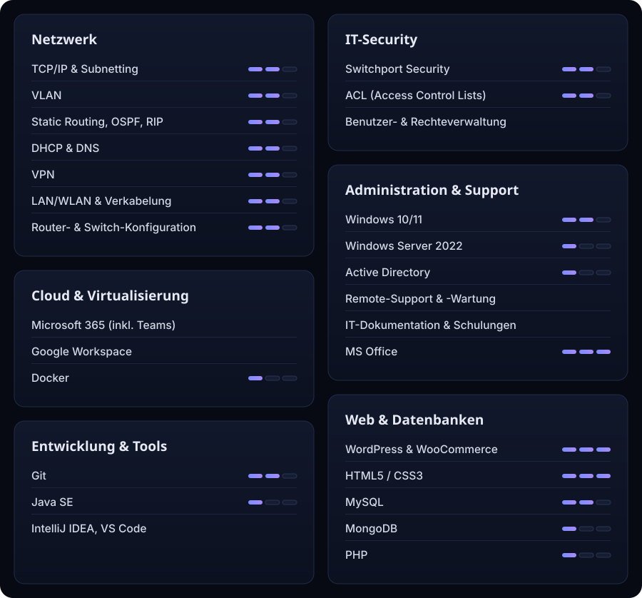

<div align="center">

<a href="https://nourbakhsh.at/">
  <picture>
    <source media="(prefers-reduced-motion: reduce)" srcset="assets/hero-de-static.svg">
    
  </picture>
</a>

<br><br>

<a href="mailto:info@nourbakhsh.at"></a>
<a href="https://nourbakhsh.at/"></a>
<a href="https://nourbakhsh.at/#contact"></a>
<a href="https://www.linkedin.com/in/babak-nourbakhsh/"></a>

[English](README.md) · **Deutsch**

</div>

## `// Über mich`

Hallo, ich bin Babak, IT-Fachkraft aus Wien mit **über acht Jahren Praxis** in IT-Support und Systembetreuung. Aktuell betreue ich als alleinverantwortlicher IT-Betreuer rund 12 Arbeitsplätze inklusive Netzwerk und Peripherie.

Mein Schwerpunkt verlagert sich bewusst in Richtung **Netzwerk, IT-Security und Systemadministration**. Nach dem Abschluss der HTL Informatik (Netzwerktechnik) 2026 studiere ich seit September 2026 berufsbegleitend **IT Security (Bachelor)** an der FH St. Pölten.

Ergänzend entwickle ich eigene Tools und Websites, etwa eine PHP/MySQL/Docker-Anwendung, die eine manuelle Excel-Lösung ablöst.

```console
$ whoami
IT-Administrator · Netzwerk & IT-Security

$ sprachen
Persisch (Muttersprache) · Deutsch (B2) · Englisch (B1)

$ naechster-schritt
Netzwerk, IT-Security oder IT-Administration
```

## `// Kompetenzen`



<details>
<summary>Kompetenzen als Text</summary>
<br>

| Bereich | Sehr gut | Gut | Grundkenntnisse | Außerdem |
|---|---|---|---|---|
| **Netzwerk** | | TCP/IP & Subnetting, VLAN, Static Routing, OSPF, RIP, DHCP & DNS, VPN, LAN/WLAN & Verkabelung, Router- & Switch-Konfiguration | | |
| **IT-Security** | | Switchport Security, ACL | | Benutzer- & Rechteverwaltung |
| **Administration & Support** | MS Office | Windows 10/11 | Windows Server 2022, Active Directory | Remote-Support & -Wartung, IT-Dokumentation & Schulungen |
| **Cloud & Virtualisierung** | | | Docker | Microsoft 365 (inkl. Teams), Google Workspace |
| **Web & Datenbanken** | WordPress & WooCommerce, HTML5 / CSS3 | MySQL | MongoDB, PHP | |
| **Entwicklung & Tools** | | Git | Java SE | IntelliJ IDEA, VS Code |

</details>

## `// Werdegang`

| | Position | Unternehmen |
|---|---|---|
| `05.2021⁠ ⁠–⁠ ⁠heute` | **IT-Support & Systembetreuung** | Apotheke Zum heiligen Leopold, Ziersdorf |
| `06.2020⁠ ⁠–⁠ ⁠05.2021` | **IT-Servicetechniker** | ishtar Multiservice und Handels GmbH / TELEprint Digitaldruck KG, Wien |
| `11.2017⁠ ⁠–⁠ ⁠05.2020` | **IT-Techniker** | MTco. e.U., Wien |
| `02.2007⁠ ⁠–⁠ ⁠01.2009` | **IT-Techniker (Hardware)** | Technic Rayaneh, Mashhad, Iran |

## `// Ausbildung & Zertifikate`

| | Ausbildung | Einrichtung |
|---|---|---|
| `09.2026⁠ ⁠–⁠ ⁠heute` | **BSc IT Security** (berufsbegleitend) | USTP – FH St. Pölten |
| `09.2023⁠ ⁠–⁠ ⁠09.2026` | **Informatik**: Netzwerktechnik, Systemadministration, Softwareentwicklung, Datenbanken | HTL Wien West |
| `09.2003⁠ ⁠–⁠ ⁠02.2007` | **Associate Degree Informatik – Software** | Islamische Azad-Universität, Ferdows, Iran |
| `in Vorbereitung` | **Cisco CCNA** | Cisco |
| `07.2025` | **Java SE** | Online-Kurs |

## `// Projekte`

| Projekt | Technik | Status |
|---|---|---|
| **Messdatenlogger-Verwaltung**<br>Datenbankgestützte Webanwendung. Löst eine manuelle Excel-Lösung ab und automatisiert wiederkehrende Abläufe. | `PHP` `MySQL` `Docker` | 🟢 Im Einsatz (intern) |
| **WordPress-Websites für Apotheke & Großhandel**<br>Konzeption, Umsetzung und laufende Betreuung. | `WordPress` `WooCommerce` `HTML/CSS` | 🟢 Live |

## `// Kontakt`

Sie suchen Verstärkung für **Netzwerk, IT-Security oder IT-Administration**? Schreiben Sie mir.

| | |
|---|---|
| **E-Mail** | [info@nourbakhsh.at](mailto:info@nourbakhsh.at) |
| **Website** | [nourbakhsh.at](https://nourbakhsh.at/) |
| **LinkedIn** | [babak-nourbakhsh](https://www.linkedin.com/in/babak-nourbakhsh/) |
| **Kontaktformular** | [nourbakhsh.at/#contact](https://nourbakhsh.at/#contact) |
| **Standort** | Wien, Österreich |
