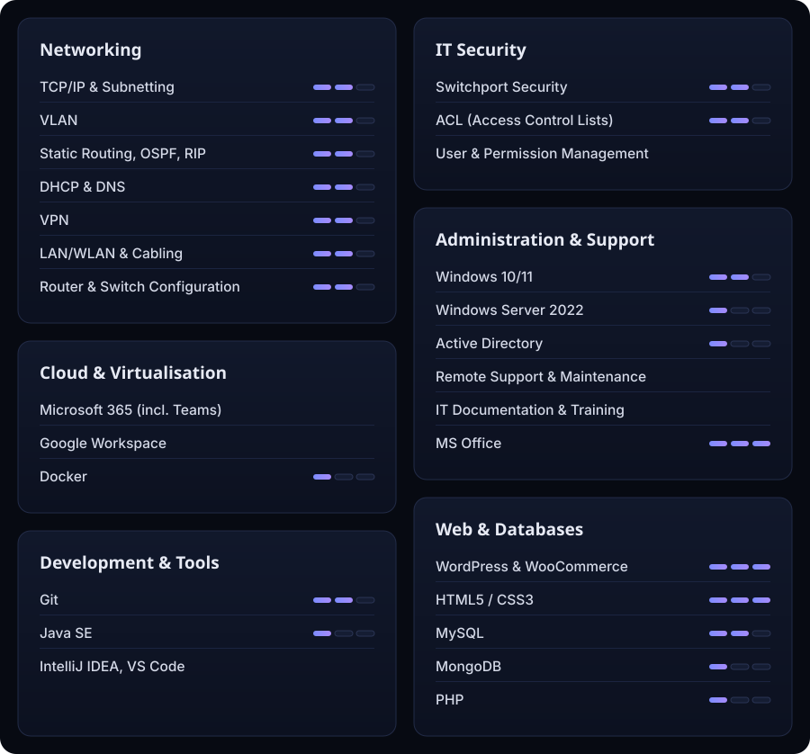

<div align="center">

<a href="https://nourbakhsh.at/en/">
  <picture>
    <source media="(prefers-reduced-motion: reduce)" srcset="assets/hero-en-static.svg">
    
  </picture>
</a>

<br><br>

<a href="mailto:info@nourbakhsh.at"></a>
<a href="https://nourbakhsh.at/en/"></a>
<a href="https://nourbakhsh.at/en/#contact"></a>
<a href="https://www.linkedin.com/in/babak-nourbakhsh/"></a>

**English** · [Deutsch](README.de.md)

</div>

## `// About me`

Hi, I'm Babak, an IT professional from Vienna with **more than eight years of hands-on experience** in IT support and system administration. I am currently the sole IT administrator for about 12 workstations, including network and peripherals.

I am deliberately moving towards **networking, IT security and system administration**. I completed HTL Informatics (networking) in 2026 and have been studying part-time for a **BSc in IT Security** at St. Pölten University of Applied Sciences since September 2026.

On the side I build my own tools and websites, such as a PHP/MySQL/Docker application that replaced a manual Excel workflow.

```console
$ whoami
IT Administrator · Networking & IT Security

$ languages
Persian (native) · German (B2) · English (B1)

$ next-step
Networking, IT security or IT administration
```

## `// Skills`



<details>
<summary>Skills as text</summary>
<br>

| Area | Advanced | Proficient | Foundational | Also |
|---|---|---|---|---|
| **Networking** | | TCP/IP & subnetting, VLAN, static routing, OSPF, RIP, DHCP & DNS, VPN, LAN/WLAN & cabling, router & switch configuration | | |
| **IT security** | | Switchport security, ACL | | User & permission management |
| **Administration & support** | MS Office | Windows 10/11 | Windows Server 2022, Active Directory | Remote support & maintenance, IT documentation & training |
| **Cloud & virtualisation** | | | Docker | Microsoft 365 (incl. Teams), Google Workspace |
| **Web & databases** | WordPress & WooCommerce, HTML5 / CSS3 | MySQL | MongoDB, PHP | |
| **Development & tools** | | Git | Java SE | IntelliJ IDEA, VS Code |

</details>

## `// Experience`

| | Role | Company |
|---|---|---|
| `05/2021⁠ ⁠–⁠ ⁠present` | **IT Support & System Administration** | Apotheke Zum heiligen Leopold, Ziersdorf |
| `06/2020⁠ ⁠–⁠ ⁠05/2021` | **IT Service Technician** | ishtar Multiservice und Handels GmbH / TELEprint Digitaldruck KG, Vienna |
| `11/2017⁠ ⁠–⁠ ⁠05/2020` | **IT Technician** | MTco. e.U., Vienna |
| `02/2007⁠ ⁠–⁠ ⁠01/2009` | **IT Technician (Hardware)** | Technic Rayaneh, Mashhad, Iran |

## `// Education & certificates`

| | Programme | Institution |
|---|---|---|
| `09/2026⁠ ⁠–⁠ ⁠present` | **BSc IT Security** (part-time) | USTP – FH St. Pölten |
| `09/2023⁠ ⁠–⁠ ⁠09/2026` | **Informatics**: networking, system administration, software development, databases | HTL Wien West |
| `09/2003⁠ ⁠–⁠ ⁠02/2007` | **Associate Degree in Informatics – Software** | Islamic Azad University, Ferdows, Iran |
| `in preparation` | **Cisco CCNA** | Cisco |
| `07/2025` | **Java SE** | Online course |

## `// Projects`

| Project | Built with | Status |
|---|---|---|
| **Data-logger management application**<br>Database-backed web application that replaces a manual Excel workflow and automates recurring tasks. | `PHP` `MySQL` `Docker` | 🟢 In production (internal) |
| **WordPress websites for a pharmacy & a wholesaler**<br>Concept, implementation and ongoing maintenance. | `WordPress` `WooCommerce` `HTML/CSS` | 🟢 Live |

## `// Contact`

Looking for someone in **networking, IT security or IT administration**? Drop me a line.

| | |
|---|---|
| **Email** | [info@nourbakhsh.at](mailto:info@nourbakhsh.at) |
| **Website** | [nourbakhsh.at](https://nourbakhsh.at/en/) |
| **LinkedIn** | [babak-nourbakhsh](https://www.linkedin.com/in/babak-nourbakhsh/) |
| **Contact form** | [nourbakhsh.at/en/#contact](https://nourbakhsh.at/en/#contact) |
| **Location** | Vienna, Austria |
